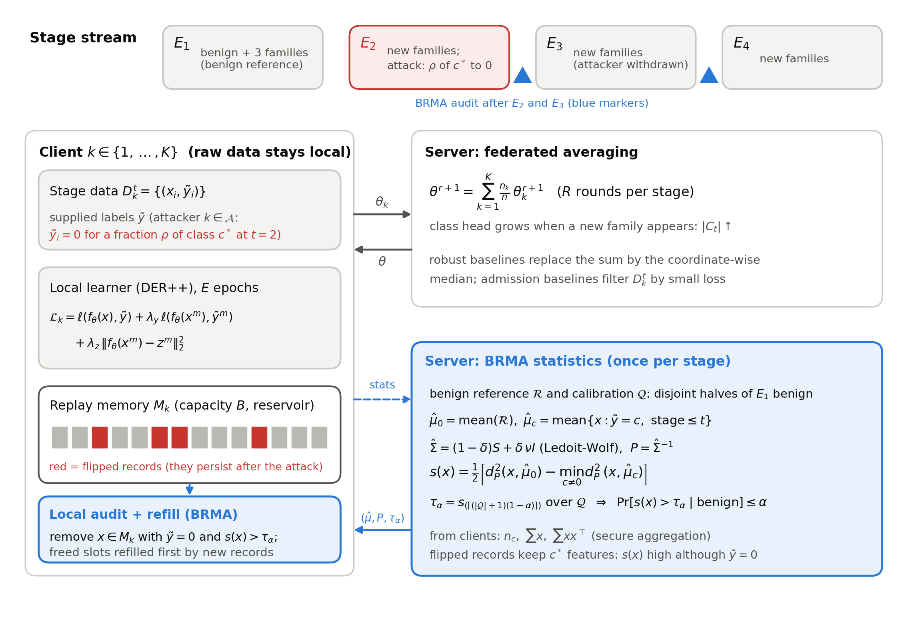

# BRMA: Benign-Reference Memory Audit for Federated Continual Intrusion Detection

Code, results and paper for

> **Removing Persistent Label Poisoning from Replay Memory in Federated Class-Incremental Intrusion Detection with a Conformal Benign-Reference Audit**
> Saneedullah and Ahmed Bilal, Department of Data Science, FAST National University of Computer and Emerging Sciences, Islamabad, Pakistan.
> [Paper (PDF)](paper/BRMA_paper.pdf) · [Poster](poster/Poster_A3_BRMA.pdf) · [Standee](poster/Standee_2.5x5ft_BRMA_print.pdf)

## Overview

In federated class-incremental intrusion detection, each client keeps a small **replay memory** so that the global model does not forget old attack families. The same memory also keeps **poisoned records**: when some clients relabel a newly arriving attack family as benign, the flipped records stay in replay and keep misleading the model after the attackers have left.

**BRMA** audits the replay memories at the end of each stage:

1. The server fits a tied-covariance Gaussian model (Ledoit–Wolf) to first-stage benign traffic and to traffic the clients label as attacks. Flipped records never enter these statistics.
2. Every benign-labelled memory record gets a likelihood-ratio score
   `s(x) = ½ [ d²(x, μ_benign) − min_c d²(x, μ_c) ]`.
3. Records with `s(x) > τ_α` are removed, where `τ_α` is a **split-conformal** threshold: genuine benign records are removed with probability at most α (5%).
4. Freed slots are refilled by the reservoir.

**BRMA-C** additionally tests the model's attack score `m(x) = max_c f(x)_c − f(x)_benign` and removes a record if either test fires at α/2, which keeps the same guarantee and also works when attack and benign flows overlap.



## Main results

| | No defence | BRMA | BRMA-C |
|---|---|---|---|
| CIC-IDS2017, attack effect H, 5 attackers | 0.586 | **0.0006** | **0.0005** |
| CIC-IDS2017, selective adaptive attackers, poison detected | – | **99.98%** | **99.96%** |
| TON_IoT (DDoS), attack effect H, 3 attackers flipping 90% (unseen seeds) | 0.641 | 0.227 | **0.021** |
| TON_IoT (DDoS), poison detected | – | 59% | **99.2–99.9%** |
| Genuine benign records removed | – | 4.5–4.9% | 4.1–4.8% |

On TON_IoT the learner reaches **89.07% macro-F1** (97.1% accuracy) with clean clients, against 74.49% F1 reported by Carillo et al. (IEEE TNSM 2026), and 88.6% under the strongest attack. Overall: **2,715 runs**, 12 seeds per study, 18 statistical tests specified in advance (13 confirmed, 5 not confirmed, all reported in the paper).

## Repository structure

```
paper/        LaTeX source (Springer Nature sn-jnl template), bibliography, figures and the compiled PDF
src/cic/      CIC-IDS2017 studies
  brma_study.py       main study: 5 attack arms x 10 methods (BRMA, controls, published defences)
  brma_adaptive.py    adaptive attackers (selective and camouflage) and the fixed-budget loss filter
  brma_margin.py      model-score (BRMA-M) and combined (BRMA-C) audits
src/ton/      TON_IoT studies (self-contained)
  ton_study.py        data preparation, federated continual learner, BRMA, baselines, tuning
  ton_improve.py      BRMA-M / BRMA-G / BRMA-C, development-seed selection and unseen-seed evaluation
notebooks/    the exact Kaggle notebooks that produced every result (01-05)
analysis/     scripts that recompute every table and test in the paper from results/raw
results/raw/  per-run result records (JSON, one per run; model weights omitted)
results/tables/  summary tables (means, bootstrap intervals, tests, audit quality)
data/         class taxonomy used for the CIC-IDS2017 metrics
poster/       A3 poster and 2.5 ft x 5 ft standee (PDF and editable PowerPoint)
tests/        smoke test for the TON_IoT pipeline on synthetic data
```

## Reproducing the results

All experiments run on CPU (deterministic, one thread per worker) on Kaggle notebooks.

| Notebook | Study | Runs | Time (4 CPUs) |
|---|---|---|---|
| `01_cic_main_study.ipynb` | CIC-IDS2017 main study (3 shards of 4 seeds) | 600 | about 2 h per shard |
| `02_cic_adaptive_attacks.ipynb` | adaptive attackers, fixed-budget loss filter | 672 | about 6.5 h |
| `03_cic_brma_m_and_c_check.ipynb` | BRMA-M / BRMA-C on CIC-IDS2017 | 360 | about 3 h |
| `04_ton_iot_tuned_study.ipynb` | TON_IoT tuning on development seeds + main study | 600 (+48 tuning) | about 4 h |
| `05_ton_iot_brma_variants.ipynb` | TON_IoT variant selection and unseen-seed evaluation | 63 + 420 | about 3 h |

**Data.**
- CIC-IDS2017 (corrected release by Engelen et al.): notebooks 01–03 download it and rebuild the 74-feature package automatically. They require Internet access and clone the federated continual-learning engine of the project repository [`ahmedbilalazhar/cl-ids-adversarial`](https://github.com/ahmedbilalazhar/cl-ids-adversarial), which the studies import unchanged.
- TON_IoT: attach the network data set (`train_test_network.csv`, 461,043 flows; official source <https://research.unsw.edu.au/projects/toniot-datasets>) as a Kaggle input to notebooks 04–05.

**Analysis.** The raw results are included, so every table and test can be recomputed without rerunning the experiments:

```bash
pip install -r requirements.txt
python analysis/cic_main_analysis.py       # Tables 4-6, tests T1-T6, audit quality
python analysis/cic_adaptive_analysis.py   # Table 9, tests T7-T10
python analysis/variants_analysis.py       # Section 6.6 exploratory tests (BRMA-M / BRMA-C)
python analysis/cic_main_figures.py        # Figures 2-5
```

The TON_IoT summaries (Tables 7 and 10, tests T11–T14) are printed by `src/ton/ton_study.py summarize` and `src/ton/ton_improve.py evaluate` and stored in `results/raw/ton_tuned` and `results/raw/ton_variants`; the CIC-IDS2017 BRMA-M / BRMA-C tests T15–T18 are in `results/raw/cic_brma_m_c/tests.csv`.

**Smoke test** (synthetic data, about one minute):

```bash
python tests/test_ton_smoke.py
```

## Citation

```bibtex
@article{saneedullah2026brma,
  title  = {Removing Persistent Label Poisoning from Replay Memory in Federated Class-Incremental Intrusion Detection with a Conformal Benign-Reference Audit},
  author = {Saneedullah and Bilal, Ahmed},
  year   = {2026},
  note   = {Manuscript}
}
```

## License

Code is released under the MIT License (see `LICENSE`). The datasets keep their original licences.
